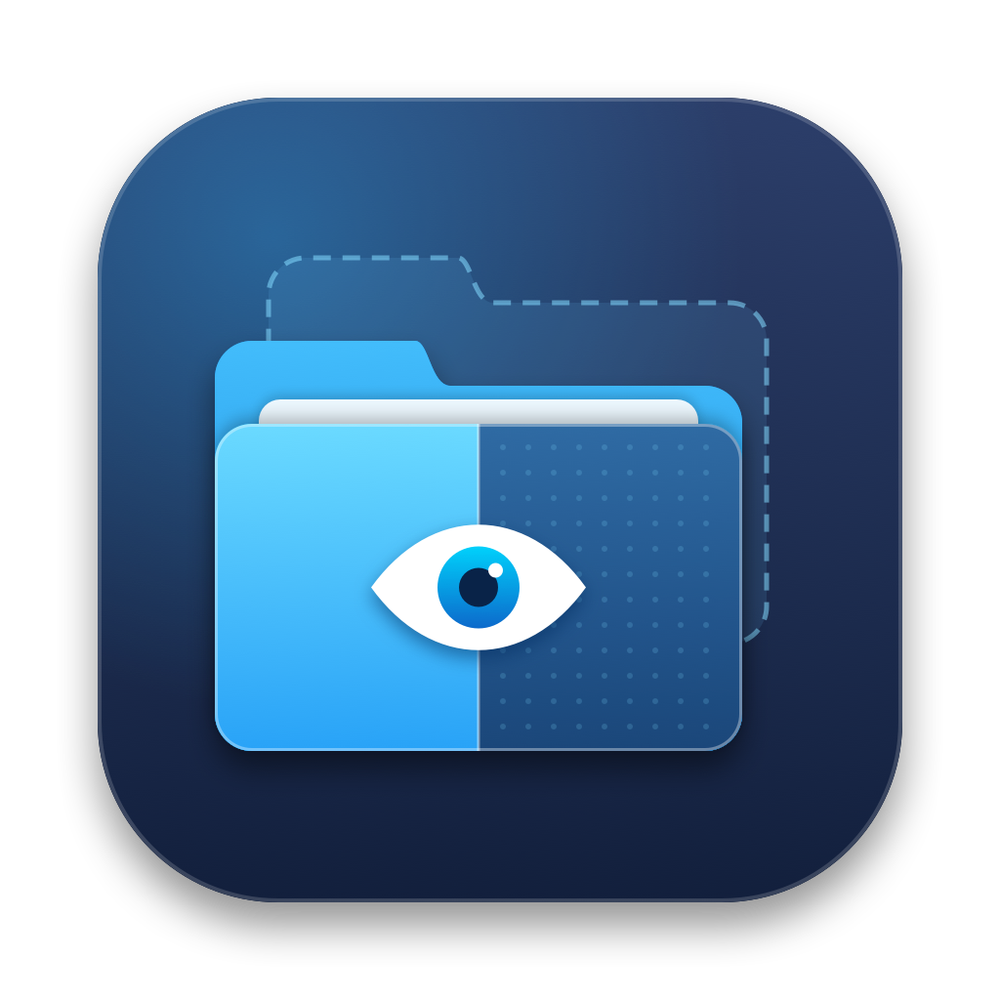
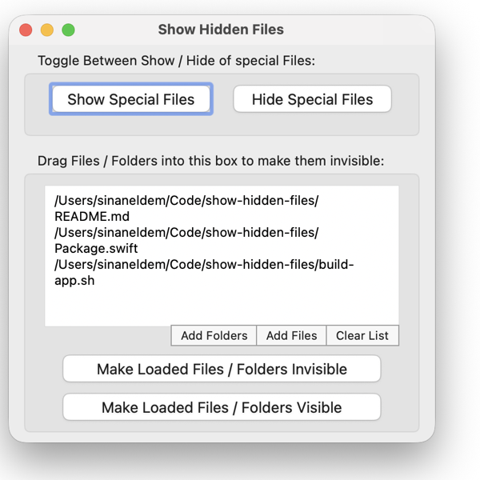

<div align="center">
  
  <h1>Show Hidden Files</h1>
  <p><strong>macOS için hafif, açık kaynak gizli dosya ve klasör aracı</strong></p>
  <p>
    
    
    
    
    <a href="LICENSE"></a>
  </p>
  
</div>

---

## Neden?

Bu uygulama, [GoToes.org](https://gotoes.org/sales/ShowHiddenFilesMacOSX/) tarafından yayımlanan klasik **Show Hidden Files** aracından esinlenerek yazıldı. Orijinal uygulama yalnızca Intel işlemciler için derlenmişti ve artık geliştirilmiyor. Bu sürüm aynı arayüzü ve iş akışını koruyarak **Swift ile sıfırdan** yazıldı ve **Universal** (Apple Silicon + Intel) olarak derleniyor. Rosetta gerekmez.

> Orijinal uygulamanın kaynak kodu kullanılmamıştır. Bu proje bağımsız bir yeniden yazımdır ve GoToes.org ile bir bağlantısı yoktur.

## Özellikler

| | |
|---|---|
| **Özel dosyaları göster / gizle** | Finder'ın `AppleShowAllFiles` ayarını açıp kapatır ve Finder'ı yeniden başlatır. `.` ile başlayan dosyalar dahil bütün gizli öğeler görünür olur. |
| **Sürükle ve bırak** | Finder'dan dosya ve klasörleri listeye ya da Dock'taki simgeye bırakın. |
| **Dosya / klasör seçici** | Gizli öğeleri de gösteren seçici penceresiyle listeye ekleme yapın. Yolları elle de yazabilir veya yapıştırabilirsiniz. |
| **Görünmez / görünür yap** | Listedeki öğeleri tek tıkla Finder'da gizleyin ya da yeniden görünür yapın. Eski `SetFile -a V` ile gizlenmiş öğeler de görünür hâle gelir. |

## Kurulum

Gereksinimler: macOS 13 Ventura veya üzeri, Xcode (Universal derleme için).

```bash
git clone https://github.com/sineld/show-hidden-files.git
cd show-hidden-files
./build-app.sh
```

Uygulama `build/Show Hidden Files.app` konumunda oluşur. Uygulamalar klasörüne kopyalamak için:

```bash
cp -R "build/Show Hidden Files.app" /Applications/
```

Geliştirme sırasında doğrudan çalıştırmak için `swift run` yeterlidir.

> Uygulama yerel (ad-hoc) imzayla imzalanır. Başka bir Mac'e kopyalarsanız ilk açılışta Finder'da sağ tıklayıp **Aç** demeniz gerekebilir.

## Nasıl çalışır?

Harici bağımlılık ya da eski Carbon araçları (`SetFile`) kullanılmaz; doğrudan macOS sistem çağrıları kullanılır:

- **Gizleme / gösterme:** Dosyanın BSD `UF_HIDDEN` bayrağı değiştirilir (`chflags -h hidden` ile aynı). Sembolik linklerde linkin gösterdiği dosyaya değil, linkin kendisine dokunulur. Dosyanın diğer bayrakları korunur.
- **Eski uyumluluk:** `com.apple.FinderInfo` içindeki `kIsInvisible` biti de güncellenir.
- **Özel dosyalar:** `defaults write com.apple.finder AppleShowAllFiles` ve ardından `killall Finder`.

Aynı işlem Finder'da <kbd>⌘</kbd> <kbd>⇧</kbd> <kbd>.</kbd> kısayoluyla geçici olarak da yapılabilir.

## Proje yapısı

```text
Sources/ShowHiddenFiles/
├── ShowHiddenFilesApp.swift      # Uygulama giriş noktası ve Hakkında penceresi
├── ContentView.swift             # Ana pencere ve durum yönetimi
├── DropTextView.swift            # Sürükle-bırak destekli liste alanı
└── FileVisibilityService.swift   # Görünürlük ve Finder işlemleri
Resources/                        # Info.plist, simge ve simge üreten betik
build-app.sh                      # Universal .app paketini derler ve imzalar
```

## Katkı

Hata bildirimleri ve pull request'ler memnuniyetle karşılanır. Lütfen bir [issue](https://github.com/sineld/show-hidden-files/issues) açarak başlayın.

## Lisans

[MIT](LICENSE) © 2026 [Sinan Eldem](https://sinaneldem.tr) · [sinan@sinaneldem.tr](mailto:sinan@sinaneldem.tr)
